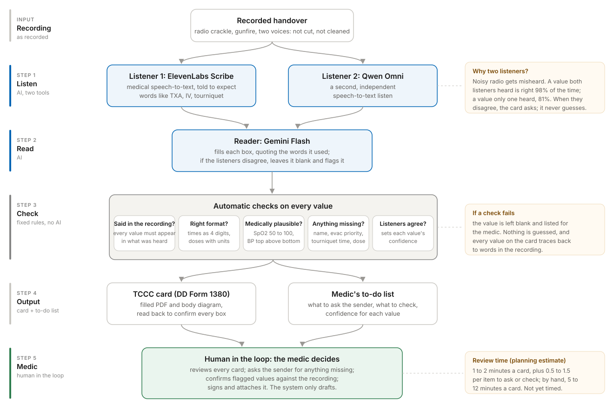

# TCCC cards from recorded handovers

Fifty casualties came through, and each one needs a TCCC card before the vehicle arrives. This project listens to
the recorded handover for each casualty and fills in the card: a PDF ready to print, plus a short sheet telling the
medic what to ask the person who handed over, and which values to check. The medic always reviews and signs; the
system only drafts.

## Quickstart

```bash
make setup && make app      # then open http://localhost:8000 (it opens by itself)
```

That is all. It needs Python 3.9 or newer and `make` (both come with macOS). No API key and no spending: all 50
cards are rebuilt from cached results. To run it live on new recordings, see "Try it live" below. Without `make`: `python3 -m pip install -r requirements.txt && python3 -m tccc`.

| Command | What it does | Cost |
|---|---|---|
| `make setup` | create `.venv` and install everything | free |
| `make app` | the app on port 8000: casualty list, each card beside its PDF, how it works, benchmark, guide | free |
| `make test` | offline unit tests, plus a check that the held-out score is still 93.8% | free |
| `make eval` | score the 25 held-out recordings, then all 50, from cached model replies | free |
| `make cards` | rebuild all 50 PDF cards and review sheets from cache | free |
| `make relisten` | simulate a third listener from cached transcripts (see `docs/DECISIONS.md`, ADR-16) | free |
| `make check-key` | check your OpenRouter key works and show spend against the cap | free |
| `make live FILE=x.wav` | one recording end to end with fresh model calls, into `out/live/` | **paid**, about 1.3 cents |
| `make live-all` | all 50 recordings with fresh calls into `out/live-all/` (cached results untouched), then scored | **paid**, about $0.65 |
| `make bakeoff` | the speech-to-text bake-off (fetches only missing transcripts) | **paid** |
| `make stop`, `make clean` | stop the app; remove Python caches | free |

**Where things land:** filled cards `out/google__gemini-3.8-flash/all/cards/*.pdf`; card data `.../predictions/*.json`;
the medic's sheet `.../review/*.md`; scored reports `out/google__gemini-3.8-flash/<split>/report.md`; every run
`out/runs.jsonl`; live recordings `out/live/`.

## Try it live with your own key

The quickstart replays cached results so you can look around for free. To run new recordings through the real
models:

```bash
cp .env.example .env                                  # then put your key after OPENROUTER_API_KEY=
make check-key                                        # free: confirms the key works, shows spend vs the cap
make live FILE=../recordings/handover-isa.wav         # one recording -> PDF, card, review sheet in out/live/
```

Or start the app (`make app`) and use **New handover** to upload a recording; the card opens when it is done.

- **What it calls:** ElevenLabs Scribe v2 Medical and Qwen 3.8 Omni Flash listen at the same time; Gemini 3.8 Flash
  reads both transcripts (GPT-6.1 Terra steps in if Gemini errors). All through OpenRouter, so one key covers all four.
- **Cost and time:** about 1.3 US cents and about 20 seconds a card; `make live-all` reruns all 50 for about $0.65 in
  about a minute and scores the fresh cards against the answer key. Each run prints what it spent.
- **Spend cap:** before any paid call the code reads your key's real usage and stops once it reaches $7. Change it
  with `TCCC_BUDGET_USD` in `.env`. If no key is found, you get a plain message saying where to put it, in the
  terminal or in the app.
- The key is read from the environment first, then `.env` in this folder, then `../.env`. It is never printed, and
  `.env` is git-ignored.

## How well it works

Before any tuning I split the 50 recordings in two: the file names sorted alphabetically, every other one set aside.
25 were for **tuning**: every instruction and rule was written from mistakes on these. The other 25 are
**held-out**: no prompt rule was written from them. They were, though, used to choose between the last two or three
models (tied on the tuning set; I picked the one that made up the fewest values) and to confirm the second listener,
and one evidence-check fix (a time spoken as "10/12") came from a held-out card. So the held-out score is slightly
optimistic.
It is still the best guide to a new recording. On those 25:

| What we measure | Score |
|---|---|
| **Accuracy on the fields the handover actually filled (F1)** | **93.8%** |
| Of the values it writes, how many are right (precision) | 97.6% |
| Safety-critical fields (drugs, doses, tourniquets, vitals, evac) | 96.8% |
| Tourniquets, and drugs and fluids | 100% each |
| Values made up that were never said | 2 in 25 cards |

On all 50 recordings (which includes the 25 it was tuned on, so it flatters a little): 94.7% F1, 97.5% precision, 96.4% on safety-critical fields. All 50 filled PDF cards are in
`out/google__gemini-3.8-flash/all/cards/`.

### How the % is calculated

A blank card already "matches" most of the form, because most fields on any one card are empty: a card that writes
nothing would score 85% if you just counted matching boxes. So I only score the fields that matter, the ones where
either the true card or ours has something written. Each is correct, wrong, made up (written but never said) or
missed (left blank when something was said). Then:

- **Precision**: of everything we wrote, how much was right.
- **Recall**: of everything that should be on the card, how much we got.
- **F1**: one number that balances the two. It only goes up if we are both careful and thorough.

Values are compared after light tidying ("800mcg" equals "800 mcg"). Free-text notes are not scored; the
body-diagram ticks are scored separately (89% on all 50, 81% on the held-out 25).

The split is fixed in code (`SPLITS` in `tccc/extract.py`: even positions tune, odd positions held-out). Every result also
has a 95% interval from resampling the cards, and a change only counts as better when the interval on the gap
excludes zero.

## How it works



1. **Listen twice.** ElevenLabs Scribe v2 Medical writes the main transcript, told which words to expect (TXA, IV,
   tourniquet, unit names). A second, different model listens to the same raw audio at the same time.
2. **Read.** Gemini 3.8 Flash reads both transcripts and returns only the fields that were said, each with the words
   it came from. Where the two transcripts disagree on a value, it leaves the box blank and flags it
   ("transcripts disagree: A says RE88206, B says RE8826").
3. **Check, in plain code.** Every value must appear in what was heard, be in the right format and be medically
   plausible (oxygen saturation 50 to 100, systolic above diastolic). Anything that fails is left blank and flagged.
   Rules that need no judgement are code, not AI: a limb tourniquet ticks "extremity", body locations map to boxes.
4. **Body diagram.** The card's outline has 163 named tick boxes. Spoken locations ("left forearm") map to them by
   a fixed lookup, so the X lands exactly where the form expects it.
5. **PDF and review sheet.** The card is written into the real DD Form 1380, read back to confirm every field
   landed, and paired with a sheet: **Missing information** (what a surgeon needs but nobody said) and **Needs
   checking** (anything garbled, corrected or in dispute).
6. **Score.** Against the answer key, with every mistake tagged by the step that caused it.

**Time it saves (planning assumptions, not measured).** Nobody has timed medics doing this, so treat these as a
starting point. Each range runs from a calm best case to a busy collection point.

- By hand: 5 to 12 minutes a card. The low end is a quiet desk (listen once, write about 22 boxes, mark the body
  diagram). The high end adds finding the right recording, re-listening through static and corrections, stopping to
  treat, and printing, signing and attaching the card.
- With the system: the medic still reviews every card (1 to 2 minutes each), plus 0.5 to 1.5 minutes for each of the
  118 things the 50 cards ask them to ask or check. The app counts these live from the cards.
- Not included: treating, triage decisions, and waiting for answers that never come (a sender who has left). Those
  stay flagged on the card. Two medics assumes a perfectly even split.

| All 50 cards | 1 medic | 2 medics |
|---|---|---|
| By hand | 4.2 to 10.0 hours (the 3 to 4 hour evacuation window is missed even in the best case) | 2.1 to 5.0 hours |
| With the system, medic reviews every card | 1.8 to 4.6 hours | 0.9 to 2.3 hours |

How to replace the assumptions with numbers: a short tabletop exercise where two or three medics each write 5 cards by
hand and review 5 system cards, timed, with a few planned interruptions.

**Human in the loop.** The system only drafts. It gives the medic what they need to judge each card quickly (the to-do
list, a confidence mark per value, both transcripts, the words behind each value); the medic decides and signs.

**Confidence.** Each value is marked by whether both listeners heard it. Across all 50 cards, values both heard are
97.9% correct; values only one heard are 81.1% correct, about nine times the error rate. The app shows each card's
share of agreed values and names the single-listener values, so the medic knows where to look first.

About 20 seconds and 1 to 2 US cents per card; all 50 run in parallel in about a minute.

## What I tested, and what I decided

I benchmarked every step on our own recordings and answer key, not on vendor claims.

| Question | Tested | Answer |
|---|---|---|
| Which speech model? | 19 models on all 50 recordings: ElevenLabs, AssemblyAI, Deepgram, OpenAI, Google, Mistral, xAI, NVIDIA, Qwen, Meta, Fish Audio, plus audio chat models | **ElevenLabs Scribe v2 Medical**: 93% of values captured, 86% on radio and noise. Deepgram Nova-3 was near the bottom (74%) |
| Clean the audio first? | 4 methods: spectral gating, radio band-pass, DeepFilterNet3, Meta Denoiser (Demucs) | **No.** Every one made hard audio worse (86% fell to 79-80% with the neural denoisers). Modern speech models are trained on noise; denoisers remove parts of words |
| Which model fills the card? | 14 models on the final prompt (OpenAI, Google, Qwen, GLM, DeepSeek, Mistral), the top 3 also on the held-out set; Anthropic models in an earlier round | **Gemini 3.8 Flash.** The top six are statistically tied (about 95%); Gemini had the best held-out score and fewest made-up values. Qwen 4 Max scored well but made up twice as many |
| A second model to verify? | Two card models side by side | **No.** They make the same mistakes (agree on 99.6% of fields): errors come from the audio, not the reading |
| A second listen? | Scribe plus a second speech model, disagreements flagged | **Yes.** It holds 21 of the 80 values Scribe misses. Held-out F1 92.5% to 93.8% (gap interval +0.2 to +2.8 points), precision 95.8% to 97.6%, identity 85% to 89.5% |
| A vision model for the PDF? | Not needed | The body diagram is named tick boxes; filling it is exact code |

The pattern behind all of it: **the audio is the ceiling, not the AI.** Changing the card model moves the score by
tenths of a point; hearing better moves it by whole points. And on a casualty card, careful beats complete: a
blank box and a flag is safer than a confident guess.

## Where it still goes wrong (honest limits)

- **Some audio is gone.** One radio recording (vdi) is mostly static; another (kdb) is 36 seconds long with about
  5 seconds of speech surviving. No model recovers them.
- **Names spelled the way they sound.** "Kaur" heard as "Carr". The second listen helps (identity 85% to 89.5%),
  and in real use the casualty's ID tag settles it, which is why the card asks for it.
- **The answer key has a few slips.** One card (roo) leaves out a TXA dose and oxygen that are clearly spoken, and
  two body-diagram entries swap left and right. I did not bend the system to match them, so they count against us.
- **One small leak, flagged.** I wrote a list of real UK unit names into the instructions after seeing units in
  the answer key, so the unit field on the held-out set is slightly flattered.

## In the real world

The medic at the casualty collection point records the handover (already happening in this scenario). About 20
seconds later the card is ready. Instead of writing 138 boxes by hand, they read a short list: what to ask the
sender before they leave ("say again tourniquet time") and the few values in dispute. They sign, and the card is
fastened to the casualty. Every value traces back to the words that were spoken.

What I would build next: a larger test set (write new handover scripts with known answers, voice them with
text-to-speech and add radio noise, so results rest on hundreds of cards, not 50); an offline mode for forward
use (NVIDIA Parakeet, run on a laptop with no internet in the same speech test, caught 80% of answer-key values
against 93% for Scribe and 52% against 86% on hard audio: a device in the field may have no network, so an on-device
model is the route to offline use, but at about 13 points of hearing accuracy it is a next step, not the default); reading missing items back to the sender in real
time; and splitting very long recordings at pauses (not needed here: the longest is 61 seconds).

## The app

The web app (`make app`) lists every casualty, most urgent first, with each card's status: **Complete**, **Missing
information** (naming what to ask for) or **Needs checking**. Each card opens in MIST order beside the filled PDF.
A benchmark page shows the results above, and a guide explains how a medic uses it.

## Cost

About $0.65 to run all 50 recordings end to end (1.3 cents a card). All development runs on the provided key
have used $4.52 of the $7 cap (checked with `make check-key` on 18 Nov 2026). Re-scoring and rebuilding cards is free because every model call is cached.

## More detail

- [`docs/DECISIONS.md`](docs/DECISIONS.md): why this technology and this shape, decision by decision, with the evidence.
- [`docs/ARCHITECTURE.md`](docs/ARCHITECTURE.md): the steps, where the loops are, how each step is scored, the
  experiments behind each choice, and known limits and next steps.
- [`AI_LOG.md`](AI_LOG.md): how I worked with AI coding tools.
